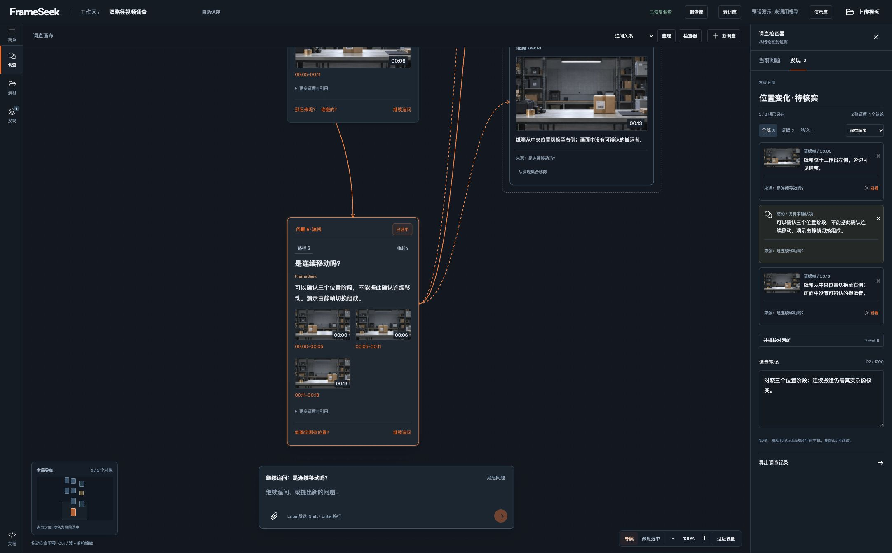

# FrameSeek

A desktop video investigation workspace: ask questions, follow up on earlier answers, and arrange verified frames and conclusions on a spatial canvas.

FrameSeek connects conversation to its source video. Questions form investigation paths; evidence can be pinned, compared side by side, played at its original timestamp and exported with notes.



## Current status

The local workspace supports multiple uploaded sources, media preflight, private playback, persistent investigations and the desktop canvas. NVIDIA/Nebius ingestion and multi-turn query adapters are implemented and tested with mock transports.

**The default is `fixture`: no model requests and no GPU provisioning.** Demo answers are preset and visibly labeled. Uploaded sources can be checked and played in this mode; they cannot receive demo answers. Live model/revision permissions, approved numeric budgets, resource cutoff calibration, quality and performance acceptance remain pending. This is not complete-MVP or production-readiness acceptance.

## Quick start

Requirements: Python 3.13, [uv](https://docs.astral.sh/uv/), and `make`. Uploaded-video preflight requires FFmpeg and ffprobe on `PATH`. The bundled synthetic demo does not require them. Local macOS execution is verified; Linux media isolation still needs deployment validation.

```sh
git clone https://github.com/zipking1988/frameseek.git
cd frameseek
make setup
make preflight
make run
```

The repository is private; cloning requires an authorized GitHub account. Open [localhost:8765](http://127.0.0.1:8765/). `make demo` starts the same server as `make run`. Stop it with Ctrl+C. Use one API/worker process per storage directory.

Useful local endpoints:

| Endpoint | Purpose |
| --- | --- |
| `/` | Investigation workspace |
| `/health` | Effective settings, local tools, readiness blockers and recorded model calls |
| `/docs` | Interactive API reference |
| `/openapi.json` | Implemented operations and answer/control schemas |
| `/docs/errors` | Error guidance |

## Try the workspace

1. Open **演示库** (demo library) and choose an investigation path. The demo uses an 18-second synthetic video made from three static scenes, not a real continuous parcel movement.
2. Select a question card and follow a suggested question, or start another supported demo question. Each card retains its own context and evidence.
3. Click a time range or evidence frame to seek the original video. Pin evidence or a conclusion, compare two frames, and add notes.
4. Rename, arrange, fold or move investigation paths. Use the minimap, **聚焦选中** (focus selected), and **适应视图** (fit canvas).
5. Use **调查库** (investigations) to create or restore work. Use **素材库** (sources) to upload, rename, inspect or delete videos.

Each investigation stores its latest 12 questions, up to 8 findings, notes, layout, path metadata, viewport, draft and player position in local SQLite. Default retention is 24 hours. Ownership follows the browser's session cookie; clearing it does not transfer access to an old investigation. There is no account-based cross-device sync.

Uploads are limited to 500 MiB per file, 10 sources/1 GiB per owner and 4 GiB across the service. Preflight checks duration, dimensions, audio and scene/window boundaries, then decodes timestamped previews. Failed or cancelled preflight can be explicitly retried. Analysis and questions for uploaded sources require configured models and approved budgets.

The product currently targets desktop browsers. A phone UI is outside this version's scope.

## Development and verification

Node.js 20+ is needed only when developing the frontend; the server serves committed local build artifacts without a CDN or Node runtime.

```sh
make test          # backend contracts, ownership, media, persistence and mocked agents
make check         # Ruff lint/format and generated-contract drift
make eval-fixture  # four synthetic output-contract examples; not a model evaluation

npm ci --ignore-scripts
npm test           # frontend state, canvas and asynchronous persistence regressions
npm run build      # React bundle and static asset content hashes
```

Edit `frontend/workbench.jsx` for React components. Authored player, canvas and persistence code lives in `src/frameseek/static/`. Rebuild after changing JSX, JS or CSS; commit the generated bundle and updated `index.html` asset hashes. Do not edit the compiled `workbench.js` directly. Output-model changes require `make schema` followed by `make check`.

The latest code review verified **109 backend and 71 frontend tests**, lint/format, contract exports and the frontend build. See [review findings, fixes and coverage limits](docs/CODE_REVIEW_20261004.md). These checks use isolated fixtures/mock transports and do not establish live model quality, GPU cost or hour-long performance.

## Architecture

```text
Desktop canvas + React workbench
              │ owned HTTP operations
              ▼
FastAPI ─── SQLite investigations / jobs / queries
   │
   ├── isolated FFmpeg preflight / timestamped media
   └── approved attempt ledger
              │
              ▼
coarse vision → embeddings / optional ASR → published index
              │
              ▼
BM25 + vector retrieval → rerank → bounded visual review → answer + evidence
```

| Location | Responsibility |
| --- | --- |
| `src/frameseek/api.py`, `routes.py`, `workspace.py` | App, owned APIs, workers and durable storage |
| `src/frameseek/agent.py`, `attempts.py` | NVIDIA/Nebius adapters, retrieval and budget reservations |
| `src/frameseek/media*.py`, `windows.py` | Media isolation, sampling and window planning |
| `src/frameseek/schema.py`, `config.py`, `preflight.py` | Output contracts, settings and readiness |
| `frontend/workbench.jsx` | React workbench components |
| `src/frameseek/static/` | Authored browser modules, styles and committed build |
| `tests/` | Python and Node regression suites |
| `docs/` | Contracts, implementation plans and verification evidence |

Private media is served through owner/expiry checks. Writes require CSRF and same-origin checks. Revision CAS prevents silent cross-tab overwrites; generations and idempotent requests protect against late results. Unknown paid attempts are retained and do not automatically resend.

## Configuration and live models

Settings precedence is environment variables → `[frameseek]` TOML → defaults. `FRAMESEEK_CONFIG` selects the TOML file; `.env.example` documents variables, but the application does **not** automatically load `.env`.

```sh
FRAMESEEK_COARSE_FRAMES=8 make preflight
FRAMESEEK_CONFIG=/absolute/path/config.toml make preflight
```

`FS_DATA_DIR` selects private storage (default `.frameseek-data/`). `FS_RUNTIME_FILE` selects a trusted runtime configuration. Keep credentials and operational runtime/approval records outside Git. See [configuration](docs/configuration.md) and the [live runtime guide](docs/WORKSPACE_RUNTIME.md).

Live mode needs verified NVIDIA/self-hosted media endpoints, Nebius text configuration, fixed model revisions, calibrated conservative costs, supplier-side resource cutoff evidence and explicitly approved owner/deployment budgets. `docs/runtime.example.json` is an intentionally blocked template; its placeholder values are neither prices nor approvals. Changing `FRAMESEEK_MODE`, ordinary settings or browser requests cannot authorize spending.

```sh
FRAMESEEK_MODE=real make preflight
```

The CLI currently always exits with code 2 in real mode and reports outstanding deployment acceptance blockers; it is not a dynamic readiness gate for a configured deployment. The app refuses unconfigured real mode rather than falling back to demo answers. FrameSeek does not provision or release GPU instances. Follow the [runtime guide](docs/WORKSPACE_RUNTIME.md) before any paid execution or deployment.

## Project documentation

- [AGENTS.md](AGENTS.md): coding-agent guidance, commands and invariants.
- [ARCHITECTURE.md](ARCHITECTURE.md): authoritative technical requirements.
- [Product scope](profile.md) and [interface direction/history](DESIGN.md).
- [API and schemas](docs/api.md), [configuration](docs/configuration.md), [errors](docs/errors.md).
- [Current runtime/workflow](docs/WORKSPACE_RUNTIME.md) and [code review](docs/CODE_REVIEW_20261004.md).
- [Implementation tasks](docs/autoplan/IMPLEMENTATION_TASKS.md), [test plan](docs/autoplan/test-plan-20261004.md) and [TODOS.md](TODOS.md).
- [Design QA](design-qa.md) and dated screenshot/test folders under `docs/`.

Historical D1 and design entries describe their state at that date; current runtime documentation takes precedence for implementation status. Remaining acceptance includes live multimodal evaluation, one-hour indexing/performance, provider billing/cutoff reconciliation, Linux isolation and deployed HTTPS/storage/backup validation.

No project license has been selected. Third-party font, icon and React license notices remain with the assets. CPU dependencies are locked in `uv.lock`; GPU models, inference images and licenses need separate validation before release.
