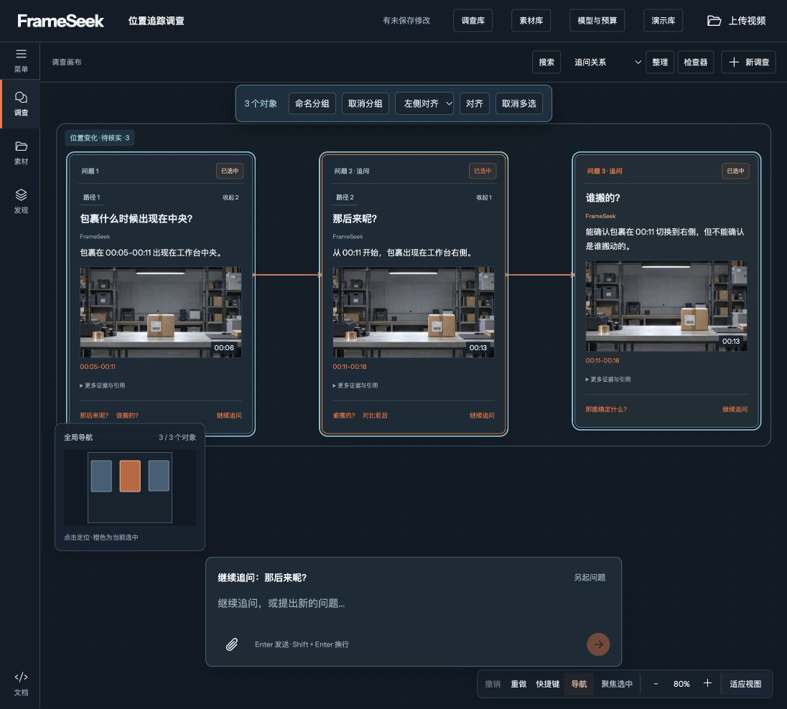
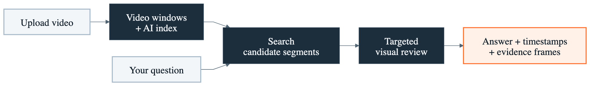

# Your Video Has the Answer. Finding It Is the Hard Part.

*Inside FrameSeek, a desktop workspace for following video questions back to timestamped evidence.*

You remember seeing it in the video. You just cannot remember where.

A package changed position. Someone mentioned a deadline. A tutorial showed the exact step you need. Now you are dragging the progress bar, replaying the same stretch and trying to decide whether you found the right moment.

Finding that moment is only the beginning. The next question is harder: **what does the footage actually prove?**

I am building **FrameSeek** around that question. It is a desktop video investigation workspace designed to connect everyday questions with source frames, timestamps and follow-up paths. The prototype runs on localhost, and its current demonstration is explicitly synthetic. Here is the experience I am building, what already works and what still needs to be tested.

*FrameSeek running locally, displaying a labelled synthetic investigation demo.*

## Three questions, one investigation

The bundled demo is deliberately small: an 18-second video assembled from three static scenes. A package appears on the left, in the centre and on the right of a workbench. Its answers are preset and clearly labelled; no model runs behind them.

Even this simple example shows why video questions need more than a paragraph of text. These are English translations of the questions and answers in the demo:

> **“When does the package appear in the centre?”**
>
> From 00:05 to 00:11. Selecting the time range or an evidence frame takes the player to the corresponding source moment.

> **“What happens afterward?”**
>
> From 00:11, the package appears on the right. The follow-up becomes another card linked to the earlier question, keeping the investigation path visible.

> **“Can we confirm who moved it?”**
>
> No. The scenes show different positions, but no person or continuous movement. The result keeps the visible evidence and marks the mover and method as unresolved.

That third answer matters. It separates an observation from an explanation. Seeing an object in two places does not establish what happened between those frames.

The same interaction pattern is intended for real uploaded videos, once model configuration, approved budgets and live validation are in place.

## Why put the investigation on a canvas?

One answer can lead in several directions. You might compare the first and last frames, check a different time range or revisit an earlier assumption.

FrameSeek gives questions, evidence frames and conclusions separate places on a spatial canvas. Users can pin a frame, compare two images side by side, group related findings and add notes. The source player stays connected to the selected evidence.

This arrangement lets you keep a supported observation next to an unanswered question. As the investigation grows, its branches remain visible and earlier evidence stays within reach.

Investigations save locally, including their layout, notes and draft questions. Findings can be exported as Markdown, JSON or an HTML report with optional embedded evidence images. The report carries timestamps and unresolved items, so someone reviewing it can see the limits alongside the conclusions.

## How a question reaches the right frames

The AI pipeline is designed around retrieval and targeted review.

*AI workflow implemented and tested with mocks; live model evaluation remains pending.*

**Prepare the source.** Local media tools check the uploaded video's metadata and divide it into bounded, overlapping windows. Overlap helps preserve context around a window boundary.

**Build searchable descriptions.** The intended model workflow creates coarse visual descriptions and, when configured, speech transcripts. Keyword and semantic retrieval use this material to find candidate segments.

**Follow the question.** The agent retrieves and reranks candidates, using verified earlier context for follow-up questions. That context needs a clear source anchor: “afterward” should refer to the event the user selected.

**Look more closely.** The agent reviews a limited set of candidate windows and assembles an answer with timestamps, frame references and unresolved questions. Users can then return to the footage to inspect those references.

The current implementation uses NVIDIA model adapters and Nebius text orchestration. Their integration has been tested with mock transports. Live model quality, latency and cost remain unverified.

A key evaluation challenge is easy to overlook: if a coarse description misses a brief event, later retrieval may never select it. Closer review cannot recover evidence from a window it never visits. I need to measure those misses as well as the quality of successful answers.

## What would make this useful outside the demo?

A shared parcel area provides one possible local use case: reviewing when an item appears, comparing its positions and recording what remains unknown. A workshop recording might need the moment a component changes. A meeting video might need the discussion around a particular decision.

These are potential uses, not completed customer deployments. The common need is concrete: find a relevant moment, inspect the source and keep enough context to ask the next question.

## What you can see today

The localhost workspace supports uploaded-video checks, private playback, persistent investigations, canvas navigation, frame comparison and report export. Uploaded sources stay separate from the synthetic demo; the application does not give real footage preset answers.

The answer contract distinguishes complete results, partial results, no supported result and processing errors. References must point to decoded frames at timestamps measured from the start of the source video. Valid references help make an answer traceable, but they do not by themselves prove the interpretation is correct.

Automated tests cover ownership, persistence, media handling, asynchronous behaviour and mocked model integration. Real-world accuracy, long-video performance and operating costs still need live evaluation.

## Help me choose the next test

My next step is to evaluate permissioned videos with annotated questions and evidence. I want to measure which events the system finds, which it misses and whether each claim is supported by its cited source.

**What is one question you have struggled to answer from a video?** Describe the type of footage and the moment you were trying to find in a comment. That would help me choose useful test cases for FrameSeek's next stage.

---

## Editorial notes — exclude from the published article

- **Programme requirement:** The supplied programme instructions require demonstrated use of Google Cloud AI tools. The current repository documents NVIDIA/Nebius integration and contains no documented Google Cloud AI integration. This draft does not yet meet that requirement. Add a Google AI section only after confirming actual use, its role and supporting evidence.
- **Local problem:** The apartment parcel scenario is illustrative, not a claim about a personally observed incident. Replace it with the author's actual local or regional experience when supplied.
- **Suggested image:** [Existing canvas screenshot](local-tools-20261005/canvas.png). Caption: “FrameSeek's desktop investigation canvas. The displayed questions and answers belong to the labelled synthetic demo.”
- **Suggested Medium tags:** Artificial Intelligence, Video, Product Development, UX, Generative AI.
- **Factual basis:** [README](../README.md), [current runtime status](WORKSPACE_RUNTIME.md), [current design note](../DESIGN.md), and [architecture contract](../ARCHITECTURE.md). No new live evaluation was performed for this article.
